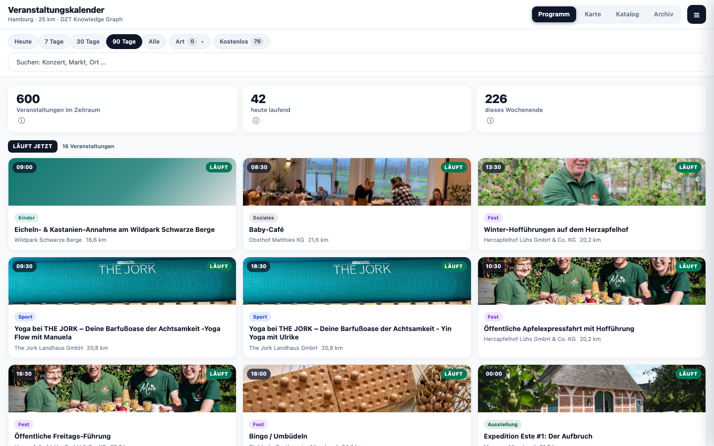
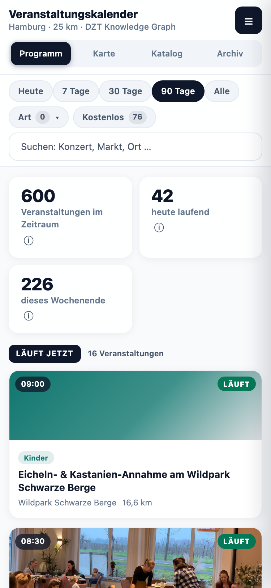
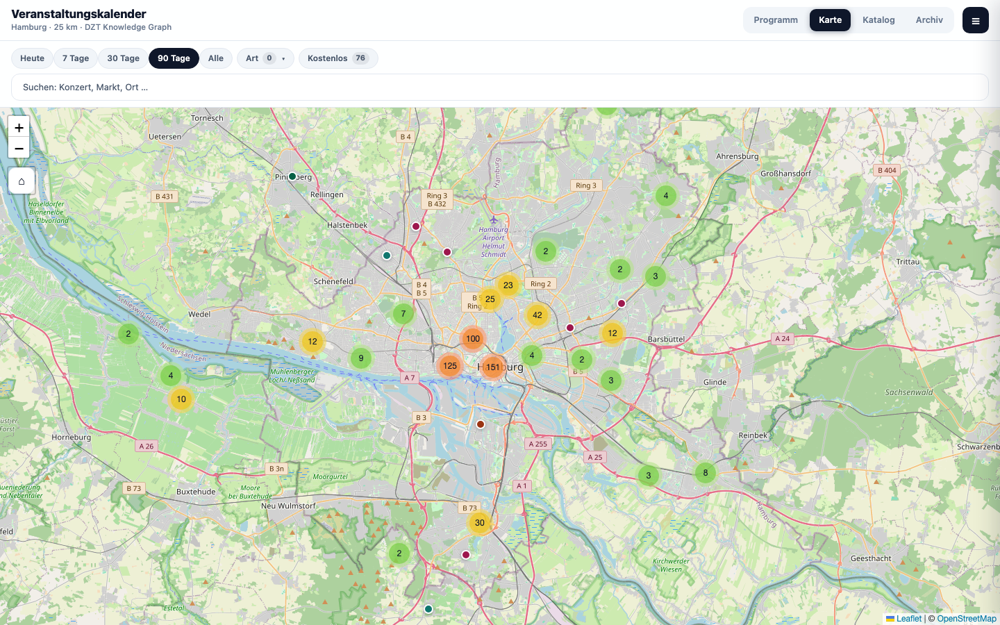
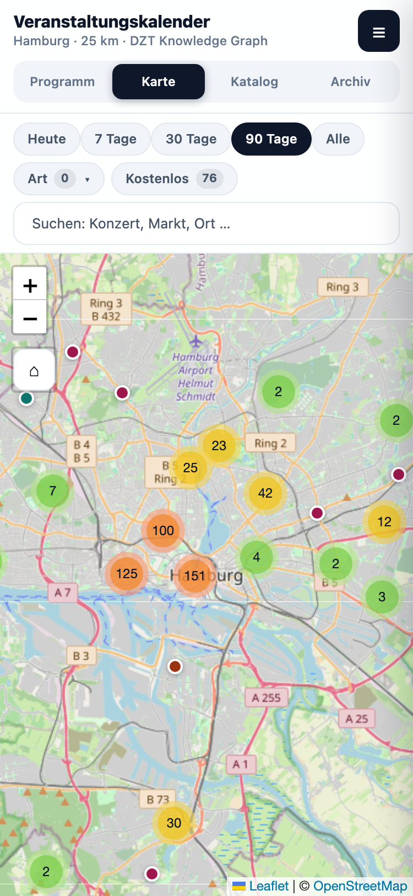
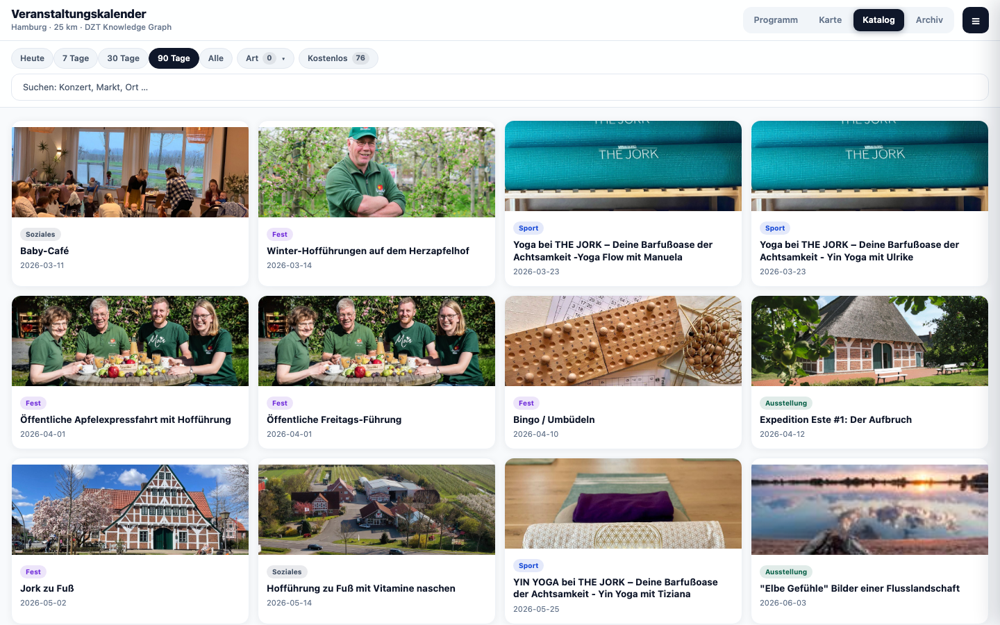
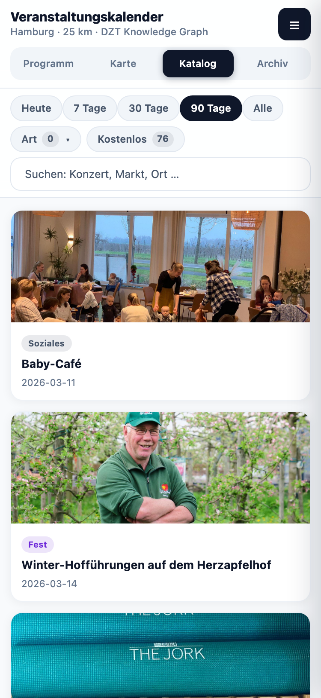

# oda-veranstaltungskalender – Veranstaltungskalender

Die App **Veranstaltungskalender** zeigt, was heute, in den nächsten Tagen oder am Wochenende in einer Kommune und ihrer Umgebung stattfindet. Grundlage sind Veranstaltungsdaten aus dem **Knowledge Graph der Deutschen Zentrale für Tourismus (DZT)**. Ein Programm nach Tagen, eine Karte, ein Foto-Katalog und ein Archiv erschließen die Daten rund um einen konfigurierbaren Ort.

Die App ist für die Verwendung im [Open Data App Store](https://open-data-app-store.de/) entwickelt und folgt der [Open Data App Spezifikation](https://open-data-apps.github.io/open-data-app-docs/open-data-app-spezifikation/).

Mehr zu Open Data Apps: <https://github.com/open-data-apps>

**Aktueller App-Stand:** 1.5.0 · [Änderungsverlauf](CHANGELOG.md)\
**Technischer Name:** `oda-veranstaltungskalender` · **Lieferpaket:** `oda-veranstaltungskalender.zip`\
**Demo-Vorbelegung:** Hamburg · 25 km; Ort und Umkreis bleiben konfigurierbar.

---

## Funktionen

Die App ist eine Single Page Application (Webapp) mit:

- konfigurierbarem Logo und Titel,
- einem gemeinsamen Vollbild-Rahmen mit Menü,
- Hauptinhalt sowie Seiten für Beschreibung, Kontakt, Impressum und Datenschutz,
- konfigurierbarer Fußzeile innerhalb des App-Rahmens.

Die Konfiguration wird vom ODAS geladen. Die App bietet folgende Inhalte:

- **Programm:** Veranstaltungen nach Tagen gruppiert, mit Uhrzeit, Art, Ort, Entfernung und Hinweis auf laufende Veranstaltungen.
- **Vier Ansichten:** Programm, Karte, Katalog und Archiv. Die Ansichtswechsel sind über Zurück/Vorwärts des Browsers erreichbar. Die Reiter unterstützen Pfeiltasten sowie Pos1/Ende.
- **Kennzahlen:** Veranstaltungen im ausgewählten Zeitraum, heute laufende Veranstaltungen und Veranstaltungen am Wochenende. Optionale Erläuterungen lassen sich ohne Höhenanimation aufklappen.
- **Filter und Suche:** Zeitraum (Heute, 7, 30, 90 Tage oder alle geladenen Ereignisse), acht Veranstaltungsarten und kostenfreie Veranstaltungen. Die Freitextsuche durchsucht Name, Beschreibung und Ort. **Kategorien werden ausschließlich aus exakten Schema-Typen ermittelt, nicht aus Stichwörtern.**
- **Karte:** Veranstaltungsorte mit Markern und Markergruppen. Die Filter wirken auch auf die Karte.
- **Foto-Katalog:** Bildergalerie für Veranstaltungen mit Bild. Einträge ohne Bild bleiben im Programm und Archiv sichtbar.
- **Archiv:** Vergangene Veranstaltungen aus dem geladenen Jahresfenster, nach Monaten gruppiert, mit eigener Kennzahl.
- **Detailansicht:** Termine, Ort, Beschreibung, Veranstalter-Link, OpenStreetMap-Ortslink („Route planen“) und Bildvergrößerung. Tab/Shift+Tab bleiben in der Bildansicht; Escape schließt zuerst diese und gibt den Fokus zurück. Detailfenster werden erst nach ihrer Ausblendung freigegeben, auch bei frühem Schließen oder Seitenwechsel.
- **Kalender-Export:** Eine ICS-Datei wird lokal im Browser erzeugt. Die Kalenderkennung unterscheidet Termine derselben Veranstaltung. Bereits mit älteren Versionen importierte Kalendereinträge werden dadurch nicht automatisch aktualisiert; erneuter Import kann einen zusätzlichen Eintrag erzeugen. Der Export überträgt keine Daten an einen Kalenderdienst.
- **Teilen:** WhatsApp, X, E-Mail und „Link kopieren“; ein geräteeigenes Teilen-Menü kommt hinzu, wenn der Browser es anbietet. Der Link enthält Veranstaltungskennung und konkreten Termin (`?event=…&termin=…`). Bekannte Termine werden direkt geöffnet, auch aus dem Archiv; unbekannte Kennungen oder Termine führen zu einem Hinweis statt zu einem anderen Datum. Alte Links nur mit `event` bleiben nutzbar, können aber nicht zwischen mehreren Terminen derselben Veranstaltung unterscheiden. Wird ein geteilter Termin nicht im kommenden Bestand gefunden, wird vor dem Nicht-gefunden-Hinweis das Archiv nachgeladen.
- **Bildnachweise:** Gelieferte Bildtitel, Rechtehinweise, Bildquellen und Lizenzlinks erscheinen erst in der Detailansicht und deren Bildvergrößerung. Programm, Katalog und Archiv bleiben frei von diesen Nachweiszeilen. Der zusätzliche Darstellungs-Hinweis entfällt; fehlende Rechte- oder Lizenzangaben werden im Detail weiterhin kenntlich gemacht.
- **Datenquelle und Methodik:** Einklappbarer Informationsblock mit optionalen Kennzahl-Erklärungen, Datenstand, weiterführenden Links und Fußzeile. Leere optionale Inhalte werden nicht angezeigt.
- **Sitzungscache:** Geladene Veranstaltungen und Ortsauflösung werden für dieselbe Konfiguration und denselben Kalendertag im Seitenkontext wiederverwendet, etwa bei der Rückkehr von einer Informationsseite. Ein neuer Seitenaufruf lädt die Daten erneut. Ein offen gebliebener Tab erneuert seinen Tagesstand bei Mitternacht beziehungsweise beim nächsten Sichtbarwerden/Fokus; verspätete Antworten des Vortags werden verworfen.

---

## Für wen ist diese App?

Die App richtet sich an Bürgerinnen und Bürger, Gäste sowie kommunale Portalbetreiber. Wer wissen möchte, was in der Umgebung stattfindet, kann sie ohne Anmeldung oder besondere Datenkenntnisse nutzen. Kommunen legen Ort und Umkreis fest und pflegen die Informations- und Rechtstexte ihrer Instanz.

---

## Datenformat

Die App verarbeitet **SPARQL-Ergebnisse im JSON-Format** (`application/sparql-results+json`) aus dem DZT Knowledge Graph. Sie erwartet `results.bindings`; eine beliebige JSON-Datei, CSV-Datei oder ICS-Quelle kann nicht als Datenquelle eingesetzt werden.

Beim ersten Laden wird die Geo-Trefferzahl geprüft. Ab 10.000 Orten wird der Suchkreis rekursiv in überlappende Teilflächen aufgeteilt, bis jede Teilabfrage unter dem nativen DZT-Ergebnisfenster bleibt. Der ursprüngliche Kreis bleibt immer als Filter erhalten. Die Geo-Orte werden in einer eigenen `SELECT DISTINCT ?loc`-Unterabfrage ermittelt, bevor die Event-Verknüpfung erfolgt. Beim Start wird nur der kommende Zeitbereich geladen. Das Archiv wird beim ersten Öffnen oder zur Prüfung eines geteilten Archivlinks nachgeladen; der geprüfte Geo-Plan wird wiederverwendet. Der Ladebalken zeigt zunächst „Ort wird bestimmt“ und „Suchgebiet wird geprüft“ ohne Prozentwert. Sobald die Zahl der Veranstaltungsabfragen feststeht, zählt er deren tatsächlich abgeschlossene Antworten (z. B. „2 von 4 Datenabfragen abgeschlossen“). Einzelne Abfragen können lange dauern; die Anzeige ist keine Restzeitprognose. Bei einem Ansichtswechsel bleibt der Fortschritt erhalten, bei Rückkehr aus dem Sitzungscache entfällt ein erneuter Abruf.

| Bereich | Zeitfenster | Globale Begrenzung eindeutiger Veranstaltungen |
| --- | --- | --- |
| Zukunft einschließlich laufender Veranstaltungen | bis zu 365 Tage im Voraus | `LIMIT 600`, nach Beginn aufsteigend |
| Archiv | vergangene 365 Tage | `LIMIT 400`, nach Beginn absteigend |

Pro Teilfläche werden eindeutige Event-IDs vor der Detailanreicherung begrenzt; anschließend werden alle Teilantworten nach Termin und ID zusammengeführt, dedupliziert und global auf 600/400 begrenzt. Pro Event wird der früheste passende Zukunfts- bzw. jüngste Archivbeginn ausgewählt. `SAMPLE` und `GROUP_CONCAT` verdichten die Detailfelder. Das interne Datenmodell ist in [`assets/schema.json`](assets/schema.json) beschrieben.

### Aufbereitung und Grenzen

- Der konfigurierte Ortsname wird über Nominatim in Koordinaten aufgelöst. Die DZT-Abfrage sucht Veranstaltungsorte im gewählten Umkreis.
- Die Veranstaltungsarten stammen aus den exakten schema.org-Typen `MusicEvent`, `TheaterEvent`, `ExhibitionEvent`, `Festival`, `SportsEvent`, `ChildrensEvent`, `FoodEvent` und `SocialEvent`.
- Termine und Kostenfreiheit werden aus Schema-Attributen gelesen; `schema:eventStatus = EventCancelled` wird bereits in der Abfrage ausgeschlossen.
- Bei Serien-Veranstaltungen werden Beginn und Ende aus `schema:eventSchedule` ergänzend berücksichtigt. Die Serie erscheint als Zeitraum; einzelne Wiederholungstermine werden **nicht** expandiert. Der ausgewählte Beginn wird bei der Detailanreicherung erneut gefiltert; der ausgegebene Ort stammt aus der Geo-Treffermenge. Bei mehreren Schedules mit identischem Beginn können unabhängig aggregierte Detailwerte weiterhin mehrdeutig bleiben; Wiederholungen werden nicht vollständig modelliert.
- Das Zukunftsfenster schließt den letzten Tag vollständig ein. Die Wochenendkennzahl zählt auch Veranstaltungen, die früher beginnen und bis ins Wochenende laufen. Der ICS-Export behandelt eine Startzeit `00:00` weiterhin wie eine fehlende Uhrzeit als ganztägig; diese bestehende Datenkonvention ist nicht neu definiert worden.
- Die Limits 600/400 gelten für **eindeutige Event-IDs im gesamten Suchkreis**. Gleiche Beginnwerte werden nach ID sortiert. Die App liefert weiterhin einen begrenzten Ausschnitt, keine vollständige Bestandszählung; größere Radien müssen bei erreichtem Limit keine Obermenge der angezeigten IDs ergeben.
- Jede Teilfläche wird einzeln über den Store-Relay geladen; kompakte SPARQL-GETs vermeiden dessen doppelt kodiertes URL-Limit. Die Teilflächen eines Zeitbereichs werden nacheinander geladen. Der Start wartet nicht auf das Archiv. Hamburg/25 km benötigte mit der neuen App-Abfrage über den unveränderten Dev-Relay **38,4 Sekunden**, die unmittelbar danach erneut gemessene Vorgängerversion **69,3 Sekunden**. Alle 600 IDs, Termine, Orte, Koordinaten, Bilder und Bildnachweise stimmen mit der Referenz überein. Das sind Einzelmessungen, keine garantierten Ladezeiten. Das Zeitlimit beträgt 75 Sekunden je DZT-Request, nicht je Gesamtabruf. Nicht ausreichend teilbare Geo-Ergebnisse werden als Fehler angezeigt, nicht still gekappt. Die Bounding-Box-Aufteilung ist auf touristische Orte in Deutschland ausgelegt, nicht auf Kreise über Polen oder der Datumsgrenze.
- Umfang, Detailtiefe und Aktualität hängen von den Datenlieferanten ab. `datenStand` ist ein konfigurierter Hinweis, kein aus den Quelldaten ermittelter Aktualisierungszeitpunkt.

### Browser-Cache und Aktualisierung

Zusätzlich zum Memory-Cache wird ein Datenstand je App-Instanz im `localStorage` gespeichert. Der Schlüssel berücksichtigt Instanzpfad, Ort, Radius, Quelle und Kalendertag. **Unter 15 Minuten** wird er beim Wiederöffnen ohne erneuten DZT-/Geocoding-Abruf angezeigt; **ältere Daten desselben Tages** bleiben zunächst sichtbar und werden im Hintergrund erneuert. Daten vom Vortag oder mit geänderter Konfiguration werden nicht wiederverwendet. Höchstalter der Wiederverwendung: 24 Stunden. Der sichtbare Ladezeitpunkt ist kein vom Datenlieferanten bestätigter Aktualitätszeitpunkt.

Bei fehlgeschlagener Hintergrundaktualisierung bleiben die gespeicherten Daten mit Hinweis sichtbar. Ein Archivfehler blockiert das Programm nicht; das Archiv kann erneut angefordert werden. Gesperrter/voller Browserspeicher oder ungültige Cache-Daten führen zum normalen Netzabruf. Gespeichert werden Event-Daten und der Geo-Plan, keine Bilddateien, Schlüssel oder Nutzungsprofile. Einträge bleiben bis zum Überschreiben oder Löschen der Website-Daten erhalten; die Nutzungsfrist ist keine automatische Löschfrist.

### Bildmetadaten

`img` enthält die mit `|` verbundenen Bild-URLs; im internen Modell wird daraus die Liste `bilder`. `bildnachweise` wird als URI-codierte Datensätze übertragen und zu Objekten mit `url`, `titel`, `lizenz`, `copyright` und `urheber` geparst. Die Codierung erhält auch Trennzeichen und Sonderzeichen innerhalb der Angaben.

Die Zuordnung erfolgt über die **exakte Bild-URL**, nicht über die Reihenfolge der Listen. Die Lizenz stammt vom jeweiligen `schema:ImageObject` (`schema:license`); die Veranstaltungslizenz `schema:sdLicense` ist kein Ersatz. Das interne Feld `urheber` enthält den gelieferten Namen aus `schema:copyrightHolder`, nicht eine unabhängig bestätigte Urheberschaft.

---

## Kompatible Datensätze

Unterstützt wird der **DZT Knowledge Graph über die SPARQL-Schnittstelle** mit den oben genannten Event-Typen und der DZT-Geo-Suche. Die Feldzuordnung ist Bestandteil der App und nicht frei konfigurierbar.

- **Datenportal:** [Open Data Destination Germany – Knowledge Graph](https://open-data-germany.org/knowledge-graphen/)
- **Datenzugriff:** [DZT-Zugriffsdokumentation](https://changelog-dzt-kg.readme.io/docs/how-to-access-the-data)
- **Ressource:** [SPARQL-Endpunkt](https://proxy.opendatagermany.io/api/ts/v1/kg/sparql)

Der SPARQL-Endpunkt wird im benannten `apiurls`-Eintrag `veranstaltungen` hinterlegt. **Die App greift ausschließlich über den ODAS-DZT-Relay `/dzt` darauf zu.** Der dafür nötige API-Key bleibt im Store; er gehört weder in die App noch in die Instanzkonfiguration. Der direkte Endpunkt ist nicht anonym nutzbar.

| Feld im App-Modell | Bedeutung | Herkunft in der SPARQL-Antwort |
| --- | --- | --- |
| `id` | Eindeutige Veranstaltungskennung | `s` |
| `name` | Veranstaltungsname | `name` |
| `typ` | Eine der acht unterstützten Arten oder unbekannt | `typ`, kommaseparierte Typ-IRIs |
| `startDatum`, `startZeit` | Beginn und gegebenenfalls Uhrzeit | `startDatum`, `startZeitRaw` |
| `endDatum`, `endZeit` | Ende, soweit vorhanden | `endDatum` |
| `ortName` | Veranstaltungsort | `ortName` |
| `adresse` | Zusammengesetzte Anschrift | `street`, `postal`, `city` |
| `lat`, `lon` | Koordinaten des Veranstaltungsortes | `lat`, `lng` |
| `distanzKm` | Luftlinie zum konfigurierten Ort | aus den Koordinaten berechnet |
| `bilder` | Bild-URLs | `img` |
| `bildnachweise` | Bildbezogene Quellen- und Rechteangaben | `bildnachweise` |
| `url` | Veranstalter- oder Detail-Link | `url` |
| `kostenlos` | Kostenfrei, kostenpflichtig oder unbekannt | `kostenlos` aus `schema:isAccessibleForFree` |

Zusätzlich verarbeitet die App `desc` als `beschreibung` für Suche und Detailansicht.

---

## Screenshots

Die sechs aktuellen Aufnahmen zeigen **Hamburg · 25 km**, aufgenommen am **12.10.2026 auf Dev mit App-Version 1.4.7**. Programm, Karte und Katalog verwenden den sichtbar ausgewählten **90-Tage-Filter**. Desktop und Mobile stammen aus derselben geladenen Sitzung mit echten Daten über den ODAS-DZT-Relay; es wurden keine Veranstaltungen ergänzt oder Testdaten injiziert. Der initiale App-Filter bleibt unverändert bei sieben Tagen.

Desktop: **1440 × 900 Pixel**. Mobile: **375 × 812 CSS-Pixel**, aufgenommen mit zweifacher Auflösung (**750 × 1624 Pixel**).

| Ansicht | Desktop | Mobile |
| --- | --- | --- |
| Programm |  |  |
| Karte |  |  |
| Katalog |  |  |

**Aufnahmegrenze:** Der Abruf dieser Sitzung lieferte 600 kommende Veranstaltungen, alle im 90-Tage-Fenster, und ein leeres Archiv. Die 600 entsprechen der globalen App-Ladegrenze, nicht dem Gesamtbestand Hamburgs. Die Bilder zeigen die Runtime 1.4.7 nach dem Geo-Fix; sie wurden im Screenshot-Paket 1.4.8 ausgeliefert und bleiben historische Ansichtsbeispiele. Ab 1.5.0 ergänzt die Oberfläche einen Ladezeitpunkt-/Cachehinweis; die Bilder sind keine Neuaufnahmen dieser Version. Bereits begonnene, noch laufende Serien können in den Karten ein älteres Startdatum tragen.

Der [maschinenlesbare Aufnahmebeleg](assets/SCREENSHOTS_HAMBURG_1.4.7.json) dokumentiert Viewports, sichtbare Bildquellen, Veranstaltungen und gelieferte Bildnachweise. Quellen, Lizenzangaben und Kartenhinweise stehen in [`assets/BILDNACHWEISE.md`](assets/BILDNACHWEISE.md). Bilder und Karten fallen nicht automatisch unter die MIT-Lizenz des App-Codes.

### Historische Aufnahmen

Die sechs Hamburg-Aufnahmen der Runtime 1.4.6 vor dem Geo-Fix bleiben mit ihren Dateinamen unverändert erhalten. Ihr [Aufnahmebeleg](assets/SCREENSHOTS_HAMBURG_1.4.6.json) dokumentiert den damaligen Ausschnitt von zwei Veranstaltungen. Sie sind nicht mehr im Screenshot-Feld des Pakets ausgewählt.

Die sechs Böblingen-Aufnahmen vom **01.10.2026, App-Version 1.3.3**, bleiben unverändert erhalten: [Desktop-Programm](assets/Desktop_Screenshot_1.png), [Desktop-Karte](assets/Desktop_Screenshot_2.png), [Desktop-Archiv](assets/Desktop_Screenshot_3.png), [Mobile-Programm](assets/Mobile_Screenshot_1.png), [Mobile-Karte](assets/Mobile_Screenshot_2.png) und [Mobile-Archiv](assets/Mobile_Screenshot_3.png). Sie sind nicht mehr die im App-Paket ausgewählten Screenshots. Ihre historischen Nachweise und offenen Lücken bleiben dokumentiert; insbesondere ist der schmale Bildstreifen am unteren Rand von `Mobile_Screenshot_3.png` (etwa Zeilen 1610–1623) weiterhin keiner konkreten Bildquelle/Lizenz belastbar zugeordnet.

---

## Systemvoraussetzungen

**Für den Betrieb:**

- Moderner Browser mit aktiviertem JavaScript.
- Eine ODAS-Instanz mit dem Dienst **`tourismus-odg`** und erreichbarem DZT-Relay.
- Erreichbarkeit von Nominatim, OpenStreetMap-Kacheln und den jeweiligen Bildservern.

**Für die lokale Entwicklung:**

- VS Code mit Live Server oder ein vergleichbarer statischer Webserver.
- Alternativ Docker mit Docker Compose sowie Make für die mitgelieferte Container-Konfiguration.
- Für die Tests: Node.js, Python 3 und Chrome/Chromium. Die dokumentierten Prüfläufe verwendeten Node.js 26.10.0 und Chrome unter macOS.
- Kein JavaScript-Buildschritt erforderlich; Programmbibliotheken liegen bereits unter `app/vendor/`.

### Starten

Für echte Veranstaltungsdaten wird die App in einer **ODAS-Instanz** betrieben:

1. Das Liefer-ZIP über die Build-Oberfläche der App hochladen und die App in einem Portal buchen.
2. Den benötigten Dienst `tourismus-odg` bereitstellen und den SPARQL-Endpunkt als `apiurls`-Eintrag `veranstaltungen` zuordnen.
3. Ort, Radius sowie die Informations- und Rechtstexte der Instanz konfigurieren. Das Paket schlägt Hamburg und 25 km vor; bereits gebuchte Instanzen separat prüfen und bei Bedarf über die Konfigurationsoberfläche umstellen.
4. Die gebuchte App-URL öffnen.

Ein Build-Upload ersetzt nicht automatisch individuell gespeicherte Instanztexte. Diese werden bei Bedarf separat in der Konfigurationsoberfläche gepflegt.

### Lokale Entwicklung mit VS Code Live Server

Den Projektordner als Server-Root öffnen, Live Server starten und `http://127.0.0.1:<live-server-port>/app/` aufrufen. Live Server verwendet gewöhnlich Port `5500`; maßgeblich ist der tatsächlich gestartete Port.

Empfohlene Einstellungen:

```json
{
  "liveServer.settings.host": "127.0.0.1",
  "liveServer.settings.root": "/",
  "liveServer.settings.file": "app/index.html"
}
```

`liveServer.settings.file` ist optional. Der Root bleibt `/`, damit `app/`, `assets/` und `odas-config/` erreichbar sind. Die lokale Konfiguration liegt in [`odas-config/config.json`](odas-config/config.json), vorbelegt mit Hamburg und 25 km. Die Template-Dateien werden für lokale Tests **nicht bearbeitet**: `getConfigUrl()` erkennt localhost und lädt die lokale Konfiguration selbst.

**Lokale Grenze:** Live Server stellt keinen DZT-Relay bereit. Ohne diesen Dienst zeigt die App den erwarteten Datenladefehler. Die Browsertests speisen stattdessen ausdrücklich synthetische Daten über [`tests/fixtures.js`](tests/fixtures.js) und [`tests/browser-fixtures.js`](tests/browser-fixtures.js) ein. Echte Relay-Tests erfolgen auf einer autorisierten ODAS-Dev-Instanz unter einem Nicht-Loopback-Host, damit nicht versehentlich die lokale Konfigurationsauflösung verwendet wird.

### Alternative: lokaler Container

Aus der Projektwurzel:

```bash
make build up
```

Die mitgelieferte `docker-compose.yml` veröffentlicht die Oberfläche unter **http://localhost:8090/** und bindet `odas-config/` schreibgeschützt ein. Dieser Mount ist erforderlich: Das Docker-Image allein kopiert die lokale Konfiguration nicht mit. Auch dieser Container stellt **keinen DZT-Relay** bereit; er ersetzt keine ODAS-Instanz für echte Datenabrufe. Beenden mit `make down`. Die Browserprüfungen verwenden Live Server, keine Docker-Laufzeitabnahme.

Optional aktiviert `make config COMPOSE_FILE=docker-compose.standalone.yml` zusätzlich das Traefik-Overlay. Dafür sind ein bereits konfigurierter Traefik, dessen externes Netzwerk `proxynet`, der Einstiegspunkt `websecure`, der Zertifikatsresolver `letsencrypt` und eine angepasste Domain statt `app1.example.com` erforderlich. Das Overlay entfernt die direkte Portfreigabe; Die verwendete Docker-Compose-Version muss das YAML-Tag `!reset` unterstützen. Es stellt weder Traefik selbst noch den DZT-Relay bereit. `make config` prüft nur die zusammengeführte Konfiguration und startet keine Container.

### Prüfungen

Syntax, JSON-Dateien und Node-Tests aus der Projektwurzel prüfen:

```bash
node --check app/app.js
node --check app/app-base.js
python3 -m json.tool app-package.json > /dev/null
python3 -m json.tool odas-config/config.json > /dev/null
python3 -m json.tool assets/schema.json > /dev/null
for t in tests/test_*.js; do node "$t" || exit 1; done
```

Für Browserprüfungen muss Live Server bereits mit der Projektwurzel als Root laufen. Den tatsächlichen Host/Port und die Chrome-Datei angeben, zum Beispiel unter macOS:

```bash
export VK_FIXTURE_HOST=127.0.0.1:5500
export VK_CHROME="/Applications/Google Chrome.app/Contents/MacOS/Google Chrome"
node tests/mobile_audit.js sekundaer
node tests/mobile_audit.js bildnachweise
node tests/mobile_audit.js modal
node tests/review_browser.js
node tests/progress_browser.js
node tests/performance_browser.js
```

Ohne Umgebungsvariablen verwendet der Harness `127.0.0.1:8765` und `google-chrome`. Jeder Lauf verwendet ein eigenes Browserprofil; standardmäßig vergibt das Betriebssystem einen freien Steuerungsport. Optional legt `VK_CDP_PORT` den Startport für Audit-Suites fest. Ungültige Suites, null Prüfungen und ungefangene JavaScript-/Promise-Fehler führen zum Fehlschlag. Der Fixture-Transport wird vor der App installiert; lokale Konfiguration wird normal gelesen, unerwartete Fetch-Ziele werden blockiert. OpenStreetMap-Kacheln bleiben bewusst echte externe Abrufe – das ist kein vollständiger Offline-Test. Die Suite `modal` prüft bewusst **mit aktiven Bootstrap-Animationen und Browserfokus**, damit Fehler beim Öffnen/Schließen nicht durch deaktivierte Übergänge verdeckt werden. Die Suite `flows` benötigt zusätzlich `VK_LIVE_HOST` (Host:Port); ihr Live-Teil erwartet die im Harness hinterlegte Audit-Instanz, keine beliebige ODAS-App.

**Prüfstand 1.5.0 (12.10.2026):** 31 Node-Testdateien und 280 lokale Browserprüfungen bestanden; Syntax/JSON/Linter geprüft. App-only Query-/Archiv-/Cache-Optimierung; Vergleichsmessungen, Testumfang und Grenzen siehe [Performance-Nachweis](docs/performance-app-2026-10-12.md). Kein Store-Umbau und kein Build-Upload; der Betreiber übernimmt den Upload.

**Historischer Prüfstand 1.4.9 (12.10.2026):** 29 Node-Testdateien, 22 gezielte lokale Browserprüfungen für den Ladefortschritt und 39 bestehende Browserregressionen bestanden (375/1440 CSS-Pixel, reduzierte Bewegung, zugänglicher Balken, Phasen, parallele Antworten, Ansichtswechsel, Fehler, Cache und Seitenwechsel-Abbruch). Browserprüfungen über Live Server mit kontrollierten Fixture-Antworten, keine echte Dev-Abnahme. Der Upload dieser Version erfolgt durch den Betreiber; die bestehenden Screenshots zeigen weiterhin die unveränderten fertig geladenen Ansichten der Runtime 1.4.7.

**Prüfstand 1.4.8 (12.10.2026):** Sechs neue echte Dev-Aufnahmen nach Geo-Fix, visuell geprüft; PNG-Abmessungen, Prüfsummen, geladene Bilder und zwölf bildgenaue Foto-Nachweise geprüft. Paket auf Dev eingespielt: alle sechs PNGs, Aufnahmebeleg, Bildnachweise und unveränderte Runtime per HTTP 200 byte-identisch ausgeliefert; Instanzkonfiguration unverändert. 28 Node-Testdateien und Konfigurations-Linter bestanden. [Liefernachweis](docs/screenshots-postupload-2026-10-12.json). Die Dateinamen 1.4.7 benennen die aufgenommene Runtime, 1.4.8 das aktualisierte Screenshot-Paket.

**Prüfstand 1.4.7 (12.10.2026):** 28 Node-Testdateien, Syntax-/JSON-Prüfungen, Konfigurations-Linter und 39 lokale Browserprüfungen bestanden. Auf Dev hochgeladen und mit 17 echten Browserprüfungen bei Desktop-/Mobile-Viewport bestätigt: 600 eindeutige kommende Veranstaltungen, davon 416 im Sieben-Tage-Fenster; alle sieben Relay-Requests HTTP 200. Individuelle Instanztexte unverändert. Geo-Regressionen, Radiusvergleiche, Ladezeiten und Liefernachweise siehe [Geo-Fix-Prüfbericht](docs/geo-fix-2026-10-12.md).

**Historischer Prüfstand 1.4.6 (12.10.2026):** 26 Node-Testdateien, Syntax-/JSON-Prüfungen und Konfigurations-Linter bestanden. Die Dev-Runtime entspricht dem lokalen `app/app.js` und verwendet Hamburg/25 km. Sechs echte Dev-Screenshots wurden mit geprüften Viewport-Maßen und geladenen sichtbaren Bildern aufgenommen; die Kartenattribution ist sichtbar. Zusätzlich bestanden 50 echte Dev-Browserprüfungen auf Desktop und Mobile-Emulation sowie nach dem abschließenden Upload alle 17 Lieferstand-Prüfungen; die neuen Beschreibungen und Screenshots werden auf Dev ausgeliefert. Details und ursprüngliche Vor-Upload-Befunde stehen im [Dev-Testbericht](docs/devtest-hamburg-2026-10-12.md). Das ist keine vollständige Abnahme aller Daten oder Geräte und kein Nachweis einer vollständigen DZT-Abdeckung.

**Historischer lokaler Prüfstand 1.4.5:** 26 Node-Testdateien und 144 gezielte lokale Browserprüfungen bestanden (Viewport-Sweep, Bildnachweise, Modal-Lifecycle und Reviewregressionen). Geprüft sind insbesondere nachweisfreie Übersichten und weiterhin vollständige Bildnachweise in Detail/Bildvergrößerung ohne Darstellungszusatz. Prüfung mit synthetischen Daten und Chrome-Mobil-Emulation, kein Dev-Upload.

**Historischer lokaler Prüfstand 1.4.4:** 26 Node-Testdateien und 238 lokale Browserprüfungen erfolgreich. Dazu bestanden zwei read-only Navigations-/Cacheprüfungen auf der weiterhin mit **1.4.3** betriebenen Dev-Instanz; sie sind keine Dev-Abnahme von 1.4.4. Die zusätzlichen Regressionen prüfen unter anderem konkrete Archivtermine, tatsächliche Zwischenablage, AX-Dialognamen, native Tastatureingaben, Tageswechsel und absichtlich ausgelöste Fehler als Negativkontrollen. Ein natives Teilen-Menü wurde für die Parameterprüfung ersetzt, nicht als Betriebssystemdialog abgenommen.

Mobile Ansichten wurden in Chrome emuliert; daraus folgt keine Abnahme auf echten Mobilgeräten, in anderen Browsern oder mit Screenreadern. Der historische vollständige Dev-Prüfstand 1.4.3 umfasst 21 Prüfungen mit echten Daten sowie sechs ergänzende Tastatur-/Schließprüfungen.

Neue Fixture-Screenshots lassen sich außerhalb von `assets/` erzeugen:

```bash
node tests/screenshot.js 375 812 /tmp/vk-mobile.png
node tests/screenshot.js 1440 900 /tmp/vk-desktop.png
```

Der Helfer wartet auf einen bereiten Kalender und die sichtbaren Bilder, prüft den tatsächlichen Viewport und verwendet einen eigenen Browser mit freiem Port. Die mobile Ausgabe hat DPR 2 (750 × 1624 Pixel), die Desktop-Ausgabe DPR 1. Ziele innerhalb von `assets/` sind gesperrt, damit die historischen Originalaufnahmen nicht versehentlich überschrieben werden.

---

## Aufbau der App

Die App basiert auf `oda-generic`. Fachlogik und HTML-Inhalte entstehen in `app/app.js` über `app(configdata, enclosingHtmlDivElement)`; app-spezifische Gestaltung liegt in `app/app.css`. `onPageLeave` räumt Ressourcen beim Seitenwechsel auf, `renderPageOverride` gestaltet die Informationsseiten im gemeinsamen Rahmen.

`app/app-base.js`, `app/app-base.css` und `app/index.html` sind unveränderte Template-Dateien. Es werden weder ein eigenes App-Backend noch ein Frontend-Buildsystem mitgeliefert. Der geschützte DZT-Zugriff ist eine Leistung der ODAS-Plattform.

### Wichtige Dateien

| Datei / Verzeichnis | Beschreibung |
| --- | --- |
| [`app/app.js`](app/app.js) | Datenabruf, Aufbereitung, Filter, Ansichten, Detailfenster, Teilen und ICS-Export |
| [`app/app.css`](app/app.css) | App-spezifische Gestaltung |
| [`app/index.html`](app/index.html), `app/app-base.js`, `app/app-base.css` | Template-eigene Laufzeit und Routing |
| [`app-package.json`](app-package.json) | ODAS-Metadaten, Version, Dienstkennung und Instanzfelder |
| [`odas-config/config.json`](odas-config/config.json) | Lokale Entwicklungs-Konfiguration; nicht Teil des Store-ZIP |
| [`assets/schema.json`](assets/schema.json) | Frictionless-Tabellenschema des App-Modells |
| [`assets/odas-app-icon.svg`](assets/odas-app-icon.svg) | App-Icon |
| [`assets/BILDNACHWEISE.md`](assets/BILDNACHWEISE.md) | Bild-/Screenshot-Nachweise, OSM-Hinweise und offene Lücken |
| `app/vendor/` | Lokal mitgelieferte Programmbibliotheken |
| [`app/vendor/THIRD-PARTY-NOTICES.md`](app/vendor/THIRD-PARTY-NOTICES.md) | Lizenztexte der mitgelieferten Bibliotheken |
| `tests/` | Node- und Browsertests sowie synthetische Testdaten; nicht Teil des Store-ZIP |
| [`Makefile`](Makefile) | Lokaler Containerbetrieb und Erzeugung des Liefer-ZIP |
| [`CHANGELOG.md`](CHANGELOG.md), [`LICENSE`](LICENSE) | Versionshistorie und Code-Lizenz |

---

## Kartenfunktion

Die Karte verwendet **Leaflet 1.9.4** und **Leaflet.markercluster 1.5.3** mit OpenStreetMap-Kacheln. Beide Programmbibliotheken werden aus `app/vendor/` geladen. Nahe Veranstaltungsorte werden zu Markergruppen zusammengefasst; Einträge ohne verwertbare Koordinaten werden auf der Karte nicht dargestellt.

Die angezeigte Entfernung ist die Luftlinie zum konfigurierten Ort, keine Wegstrecke. Der Link „Route planen“ öffnet den Veranstaltungsort auf OpenStreetMap; die App selbst berechnet keine Route. Die Kartenattribution bleibt sichtbar. Bedingungen für OSM-Daten und gerenderte Kartenbilder sind von den Veranstaltungsbildern getrennt zu betrachten.

---

## Konfiguration (Instanz)

Die verfügbaren Felder sind in [`app-package.json`](app-package.json) unter `instanz-config` definiert. Die lokale Konfiguration spiegelt diese Felder; sie ist kein zusätzliches Online-Konfigurationssystem.

### Daten und Darstellung

| Parameter | Bedeutung / Vorbelegung | Pflicht |
| --- | --- | --- |
| `ort` | Ortsname für die Geokodierung; im Paket und lokal Hamburg | ja |
| `radiusKm` | Umkreis: 5, 10, 25 oder 50 km; Standard `25` | ja |
| `apiurls` | Benannter Eintrag `veranstaltungen` mit SPARQL-Endpunkt; Laufzeitformat: Array aus `name`, `label`, `url` | Eintrag ja |
| `urlDaten` | DZT-Zugriffsdokumentation für die Datenquellen-Verlinkung | nein |
| `datenquelleHinweis` | Methodiktext; Markdown im Paket, leer blendet ihn aus | nein |
| `datenStand` | Frei gepflegter Datenstand-Hinweis; keine automatische Aktualitätsgarantie | nein |
| `weiterfuehrendeLinks` | Weiterführende Links; Markdown im Paket | nein |
| `kpiKontext1` | Erläuterung zur ersten Kennzahl, im Archiv zur Archivanzahl | nein |
| `kpiKontext2` | Erläuterung zu heute laufenden Veranstaltungen | nein |
| `kpiKontext3` | Erläuterung zu Veranstaltungen am Wochenende | nein |

### Basisfelder der ODAS-Vorlage

| Parameter | Bedeutung | Pflicht |
| --- | --- | --- |
| `titel` | Sichtbarer App-Titel | ja |
| `seitentitel` | Titel des Browser-Tabs | ja |
| `icon` | Konfiguriertes Logo; Paketdefault ist das Portallogo | ja |
| `beschreibung` | Inhalt von „Über diese App“ | ja |
| `kontakt` | Kontaktangaben des Portalbetreibers | ja |
| `impressum` | Anbieter- und Impressumsangaben | ja |
| `datenschutz` | Datenschutzangaben einschließlich der tatsächlichen Drittanbieter-Kontakte | ja |
| `fusszeile` | Abschlusszeile innerhalb des App-Rahmens | ja |
| `brandingCSS` | Optionaler zusätzlicher CSS-Code | nein |
| `brandingCSSFile` | Optionale URL zu einer Branding-CSS-Datei | nein |

Markdown-Felder werden im Paket als Markdown verfasst und von ODAS als HTML ausgeliefert; `odas-config/config.json` enthält den gerenderten lokalen Stand. Numerische Dropdown-Werte wie `radiusKm` sind in der Konfiguration Strings.

Diese App verwendet **immer den speziellen DZT-Relay**. Es gibt keinen Schalter `proxyAktiv`, keinen allgemeinen `/odp-data`-Abruf und keinen direkten DZT-Fallback. Eine Instanz ohne konfigurierte Datenquelle zeigt einen entsprechenden Hinweis statt eines Datenabrufs.

---

## Beim Aufruf kontaktierte Drittanbieter

Programmbibliotheken werden ausschließlich lokal aus `app/vendor/` geladen, nicht von einem CDN. Die App bindet kein Facebook-SDK, keine fremden Social-Media-Skripte und keine Zählpixel ein.

| Dienst / Ziel | Zweck und Zeitpunkt |
| --- | --- |
| ODAS-DZT-Relay `<App-Basis>/dzt?path=…` | Der Browser kontaktiert den Store beim Datenabruf; dieser fragt den DZT Knowledge Graph serverseitig ab. Der Key bleibt im Store. |
| `nominatim.openstreetmap.org` | Geokodierung des konfigurierten Ortsnamens beim Laden, sofern kein passender frischer Browser- oder Sitzungscache vorliegt. Es wird keine Geräteposition abgefragt. |
| `tile.openstreetmap.org` | Kartenkacheln beim Öffnen bzw. Bewegen der Karte. |
| Bildserver der Datenlieferanten, unter anderem `mein.toubiz.de` | Direkte Bildabrufe aus dem Browser entsprechend den gelieferten Bild-URLs. Die Hostliste ist vom Datenbestand abhängig. |

Bei direkten externen Abrufen erhalten die Zielserver technisch notwendige Verbindungsdaten, darunter die IP-Adresse des Geräts. Zusätzliche Kontakte entstehen **erst beim Anklicken** von Bildquellen, Lizenzlinks, Veranstalter-/Informationslinks, OpenStreetMap-Ortslinks oder Teilen-Diensten. WhatsApp verwendet `wa.me`, X `x.com`; E-Mail öffnet das konfigurierte Mailprogramm. Kopieren und ICS-Erzeugung erfolgen lokal, das geräteeigene Teilen-Menü wird vom Browser bzw. Betriebssystem bereitgestellt.

---

## Auslieferung

Das ZIP wird aus der Projektwurzel neu erzeugt:

```bash
make zip
```

Das Makefile erzeugt zunächst ein frisches temporäres ZIP und ersetzt das bisherige Archiv erst nach erfolgreichem Packen. Gelöschte Dateien bleiben daher auch bei wiederholten Builds nicht im ZIP; ein fehlgeschlagener Packvorgang erhält das vorherige Paket. Der Dateiname ergibt sich aus dem Ordnernamen.

`make check-app` benötigt zusätzlich das außerhalb dieses Repositories liegende Prüfskript `../odas-tools/app-check.sh`. Fehlt es, bricht das Ziel mit einer erklärenden Meldung ab; das ist keine erfolgreiche App-Prüfung. Die oben dokumentierten lokalen Tests funktionieren unabhängig davon.

Das Lieferpaket enthält:

- `app/`
- `assets/` einschließlich Screenshots, Datenschema und Bildnachweisen
- `app-package.json`
- `CHANGELOG.md`
- `LICENSE`

**Nicht enthalten:** README, lokale Konfiguration, Tests und Entwicklungswerkzeuge. Das ZIP ist ein Build-Artefakt und wird nicht in Git eingecheckt. Eine reine README-Änderung verändert daher weder das Lieferpaket noch den bereits hochgeladenen App-Build.

---

## Autor

© 2026, **Ondics GmbH** · <https://www.ondics.de>  
Repository-Verweis: <https://github.com/D3nn1s-7/oda-veranstaltungskalender>

## Lizenz

Der **App-Code** steht unter der [MIT-Lizenz](LICENSE). Die vollständigen Lizenztexte der mitgelieferten Bibliotheken stehen in [`app/vendor/THIRD-PARTY-NOTICES.md`](app/vendor/THIRD-PARTY-NOTICES.md). Beide Dateien sind im Lieferpaket enthalten.

| Bibliothek | Version | Lizenz |
| --- | --- | --- |
| Bootstrap | 5.3.8 | MIT |
| Leaflet | 1.9.4 | BSD-2-Clause |
| Leaflet.markercluster | 1.5.3 | MIT |

**Veranstaltungsbilder und Karten sind nicht automatisch MIT-lizenziert.** Die aktuellen Hamburg-Aufnahmen enthalten zwölf unterschiedliche sichtbare Foto-URLs, deren direkt gelieferte Bildnachweise jeweils CC BY 4.0 deklarieren. Titel, Rechtehinweise, Quellen und Vorkommen sind in `assets/BILDNACHWEISE.md` aufgeführt. Das CC0-Foto „KLIMA KALIMA“ gehört zum historischen Hamburg-Satz 1.4.6. Die historischen, am 02.10.2026 per DZT-MCP geprüften 20 Bildobjekte aus 15 Veranstaltungen deklarieren 17 × CC BY-SA 4.0 und 3 × CC0 1.0. Diese ältere Prüfung umfasst auch zusätzliche, nicht als Screenshot-Motive belegte Bilder und wird nicht auf die neuen Aufnahmen oder alle DZT-Bilder übertragen.

Einzelbildangaben, Lizenzlinks, Zuschnitt-Hinweise und separate OSM-Hinweise stehen in [`assets/BILDNACHWEISE.md`](assets/BILDNACHWEISE.md). ShareAlike-Bedingungen für Bildbearbeitungen stellen den unabhängigen App-Code nicht automatisch unter CC BY-SA. Die nicht zugeordnete Bildkante in der historischen Datei `Mobile_Screenshot_3.png`, unvollständige historische Rechteangaben und die nicht abschließend geprüften Kartenbildbedingungen bleiben **bewusst offen**. Die Dokumentation ist keine unabhängige Bestätigung der Rechteinhaberschaft oder sämtlicher Persönlichkeits- und Datenschutzrechte.
